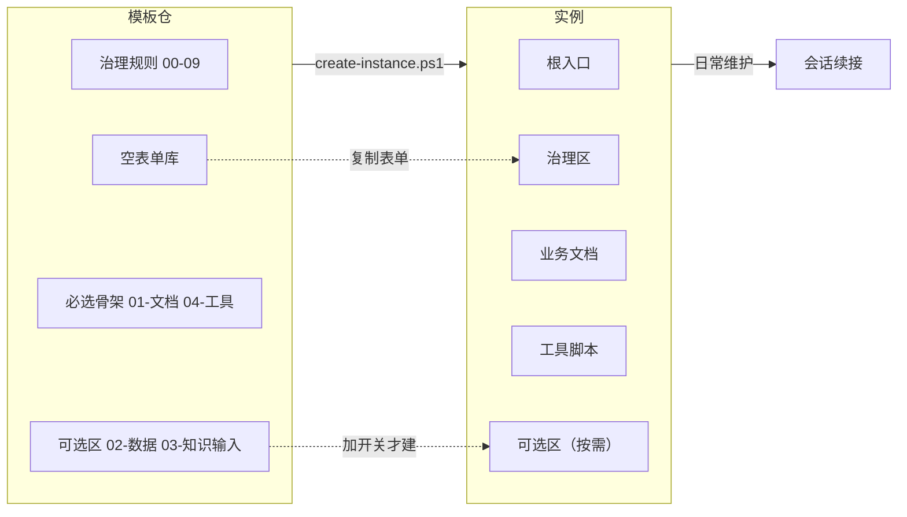

# 工作区管理模板说明（_workspace-template）

> 版本：v1.6.0（三段式，单一审计入口 = 根目录 `VERSION`）　|　模板仓：独立 git 仓　|　设计原则：**复制即用**——模板包顶层结构 = 实例骨架。

## 一分钟看懂（总览）

**这是什么**：一份「复制即用」的工作区骨架。拷贝一份 → 填几个占位符 → 就是一个新工作区。模板只规定**怎么管理文档**（规则、索引、续接），不规定**管理什么**（业务目录由实例自己定）。



**一句话工作流**：模板仓（一套通用规则）→ `create-instance.ps1` 复制（默认 `follow` 同步模式，`-SyncMode independent` 选独立管理）→ 新实例（默认 3 个目录）→ 按 `05-落地检查清单.md` 走 4 个阶段 → 日常通过 `_handoff/` 续接进度、发现可回流经验写 `_workspace/_回流提案.md` → 模板更新用 `sync-template.ps1` 下行同步（留痕于实例 `_workspace/_同步记录.md`）。

**谁读什么**：
- **新用户 / 第一次接触本模板**：`使用手册.md`（新手教程，从头跟走）。
- **想先理解全貌**：本文件的「一分钟看懂」→ `_workspace/00-总入口.md`。
- **要建一个新工作区**：看下面「创建实例」。
- **要维护模板本身**：看「同步模板更新」与「版本管理」。

## 模板结构（顶层 = 实例骨架）

| 路径 | 复制到新实例后的作用 |
|---|---|
| `README.md` / `AGENTS.md` / `CLAUDE.md` | 实例根入口（人类 / Codex / Claude） |
| `.trae/rules/00-工作区入口.md` | Trae 规则委托文件（alwaysApply 兜底，链回 `_workspace/00-总入口.md`；Trae 原生识别 `AGENTS.md` 与 Codex 同链路，此文件防个别版本识别差异） |
| `_workspace/` | **治理区**：全局规则（00-12）、空表单库 `_表单/`、术语数据 `_术语/`（两层）、实例参考 `_参考示例/`、`AGENTS.md` 入口、落地清单、.gitignore、续接模板；`10-模板同步.md`（同步模式机读块+同步/回流/切回规则）、`11-实例规则.md`（成员自立条款，模板永不覆盖）、`12-术语管理.md`（术语两层机制正本）、`_回流提案.md`（实例→模板仓提案收件箱）、`_同步记录.md`（sync -Apply 自动留痕） |
| `01-文档/` `04-工具/` | 业务目录骨架（**必选**，README + AGENTS）；`01-文档/00-规范/` 预置四份通用工程规范（图表建模/文档评估/编码变更控制/数据纪律，实例化后归实例维护） |
| `02-数据/` `03-知识输入/` | **可选区**（**默认不建**，加 `-IncludeOptionalZones` 一并创建；README + AGENTS） |
| `模板-工作区.code-workspace` | VS Code 打开入口（改名为 `<实例名>.code-workspace`） |
| `_模板维护/` | **模板仓自身脚本与记录，不复制到实例**：`create-instance.ps1`、`sync-template.ps1`、`提案/`（历史优化建议归档） |
| `模板说明.md` `使用手册.md` `CHANGELOG.md` | **模板仓自身文件，不复制到实例** |
| `CHANGELOG-PLAIN.md` / `VERSION` | **随骨架复制进实例**：CHANGELOG-PLAIN（sync: auto，大白话版更新说明，实例根）；VERSION（模板当前版本，供同步记录引用） |

> 关于三个入口文件的通俗解释：`README.md` 给人看（这个工作区装了什么）；`AGENTS.md` 给 Codex 看（Trae 也原生读它，同链路）；`CLAUDE.md` 给 Claude Code 看——两者都 `@` 导入 `_workspace/00-总入口.md`，让 AI 从任意子目录启动都能被引导到全局规则。Trae 侧另有 `.trae/rules/00-工作区入口.md`（alwaysApply）兜底。

## 创建实例（三选一）

> 详细走读（含每步核对点和常见报错）见 `使用手册.md` 第 4-5 节；本节是速查版。
> 命令风格：`powershell.exe -NoProfile -ExecutionPolicy Bypass -File ...` 完整形式可绕过执行策略限制；已放宽执行策略的机器上 `& <脚本>` 等价。

### 方式 A：一键脚本（推荐）

```powershell
# 核心骨架（_workspace + 01-文档 + 04-工具）
powershell.exe -NoProfile -ExecutionPolicy Bypass -File <模板仓>\_模板维护\create-instance.ps1 -Name <实例名> [-Parent <父目录>]

# 含可选区（+ 02-数据 + 03-知识输入）
powershell.exe -NoProfile -ExecutionPolicy Bypass -File <模板仓>\_模板维护\create-instance.ps1 -Name <实例名> -Parent <父目录> -IncludeOptionalZones
```

自动复制骨架（排除模板自身文件）并生成 `<实例名>.code-workspace`。

### 方式 B：手动复制

1. 复制整个模板仓目录 → 改名 `<实例名>/`（或 `git clone` 远端后复制）。
2. 删除模板自身文件：`模板说明.md`、`使用手册.md`、`CHANGELOG.md`、`_模板维护/`、根 `.gitignore`、`.git`。
3. `模板-工作区.code-workspace` 改名 `<实例名>.code-workspace`。
4. 按 `_workspace/05-落地检查清单.md` 走阶段 1-4（git init / 填目录索引 / 首提交）。

### 方式 C：AI 辅助

在目标父目录（或实例目录）启动 AI CLI，按下表说法发指令，AI 读模板说明后执行方式 A：

| 场景 | 可以直接对 AI 说 |
|---|---|
| 创建工作区 | 「基于 `<模板仓路径>` 创建工作区 `<实例名>`，放在 `<父目录>`；不创建数据区和知识输入区。」 |
| 创建含可选区的工作区 | 「基于模板创建 `<实例名>`，同时创建 `02-数据` 和 `03-知识输入`。」 |
| 开始或续接任务 | 「处理 `<任务>`。先读取当前工作区规则和唯一索引 `_workspace/_handoff/README.md`，再跟随其顶部主线程指针。」 |
| 调整目录或迁移内容 | 「把 `<内容>` 迁移到 `<目标目录>`；更新登记和引用，保留原始资料。」 |

AI 应先读规则、再说明要改哪些文件和为什么；涉及只读目录、删除、提交、推送时会向用户确认。

## 同步模板更新到已建实例

```powershell
powershell.exe -NoProfile -ExecutionPolicy Bypass -File .\_模板维护\sync-template.ps1 -Instance <实例目录>          # dry-run：只报告差异
powershell.exe -NoProfile -ExecutionPolicy Bypass -File .\_模板维护\sync-template.ps1 -Instance <实例目录> -Apply    # 应用 auto 文件（模板权威）
```

- **同步模式门禁（v1.6，两级）**：执行前读实例 `_workspace/10-模板同步.md` 机读块——dry-run 任何模式可跑（独立模式下作为切回前盘点工具）；`-Apply` 仅 `follow` 可执行，`independent`（独立管理）一律拒绝，恢复须用户确认后主动改回（切回四步见 10 号）。缺文件/块按 follow 兼容旧实例。`-Apply` 自动向实例 `_workspace/_同步记录.md` 追加一行（日期/模板 VERSION/auto 已同步/manual DIFF 清单）；manual 文件同步输出按内容比对标 SAME/DIFF，不再是全量列出。auto 组出现 DIFF = 实例改动过方法论文件的信号，按 10 号裁决流程处理。
- `sync: auto`（可安全覆盖，模板权威）：`CHANGELOG-PLAIN.md`（实例根）、`06-AI执行环境.md`、`12-术语管理.md`、`_handoff/_模板-续接文档.md`、`_表单/_模板-数据源登记表.md`、`_表单/_模板-需求文档雏形.md`、`_表单/_模板-编码任务卡.md`、`_术语/README.md` 与 `_术语/通用-*.md`（术语两层，v1.7 起；机制正本 v1.8 起在 12 号）；auto 文件头部带 Sync notice（实例内不得直接修改，通用改进写实例 `_workspace/_回流提案.md` 回流）。
- `sync: manual`（实例化文件，需人工合并）：目录索引 / 跨目录约束 / git 管理 / 落地检查清单 / 通用文档管理原则 / 工具管理 / README / AGENTS / 业务骨架 / 参考示例等（落地检查清单与通用文档管理原则 2026-09-15 由 auto 改判 manual：两文件含实例化占位与实例定制内容，-Apply 会覆盖；先例：工具管理 08-17 改判）。
- 挂载登记（`_workspace/07-VSCode工作区挂载登记.md`，sync: manual）与同步脚本（`04-工具/03-工作区治理/sync-vscode-workspace.ps1`，.ps1 不参与 sync 扫描）由 create-instance 复制进实例；脚本为推导式默认路径，放实例 `04-工具\03-工作区治理\` 下即可直接运行。
- sync 标记允许位于文件前 4 行内（v1.4）：`.trae/rules/00-工作区入口.md`（sync: auto）要求 Trae front-matter（`--- alwaysApply ---`）置于第 1 行，模板标记随其后；sync-template.ps1 扫描前 4 行匹配标记。

## 版本管理

- 版本号 `v<主>.<次>`，历史见 `CHANGELOG.md`。
- 模板文件头部 front-matter：`<!-- 模板 vX.Y | sync: auto/manual | target: <实例路径> -->`。
- 修改模板后：升版本号 + 登记 CHANGELOG + commit。
